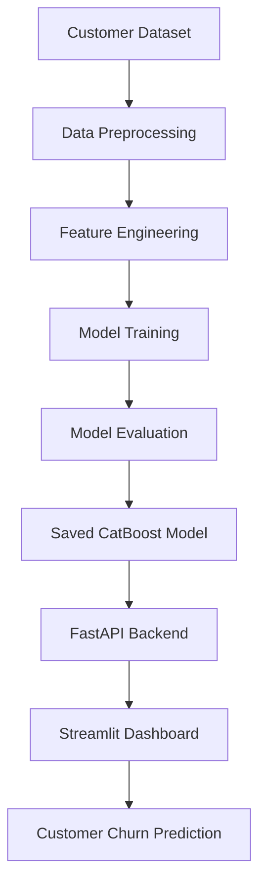

# ChurnAI – Customer Churn Prediction System

An AI-powered Customer Churn Prediction System that predicts whether a bank customer is likely to leave using machine learning.

## Project Overview

Customer churn is a major challenge for banks and financial institutions. Identifying customers who are likely to leave helps businesses take proactive retention measures.

ChurnAI uses machine learning to analyse customer information and estimate the probability of customer churn.

## Features

- Customer churn prediction using CatBoost.
- Machine learning model comparison.
- Customer churn distribution analysis.
- ROC curve visualization.
- Feature importance analysis.
- Interactive customer prediction form.
- REST API using FastAPI.
- Dark emerald green analytics dashboard using Streamlit.

## Technologies Used

| Category | Technologies |
|---|---|
| Programming Language | Python |
| Machine Learning | CatBoost, Scikit-learn |
| Data Processing | Pandas, NumPy |
| Visualization | Plotly |
| Backend | FastAPI |
| Frontend | Streamlit |
| Model Storage | Joblib |

## Dataset

**Dataset:** Churn Modelling Dataset

- Total records: 10,000
- Input features: 10 original customer features
- Target variable: `Exited`
- 0 – Customer stayed
- 1 – Customer exited

## Model Performance

The original CatBoost model achieved the following results on the project's existing test split:

| Metric | Result |
|---|---:|
| Accuracy | 87.20% |
| Precision | 76.68% |
| Recall | 53.32% |
| F1 Score | 62.90% |
| ROC-AUC | 87.18% |

*Note: These are experimental project results from the existing test split, which was used during model experimentation.*

## System Architecture



## Project Structure

```text
ai_model/
│
├── .streamlit/
│   └── config.toml
│
├── api.py
├── app.py
├── README.md
├── requirements.txt
│
├── data/
│   └── raw/
│       └── Churn_Modelling.csv
│
├── models/
│   ├── catboost_model.pkl
│   ├── catboost_preprocessor.pkl
│   └── catboost_threshold.json
│
├── results/
│   ├── model_comparison.csv
│   └── catboost_results.csv
│
└── src/
    └── feature_engineering.py
```

## Installation and Setup

### 1. Clone the repository

```bash
git clone YOUR_GITHUB_REPOSITORY_URL
cd ai_model
```

### 2. Create a virtual environment

```bash
python -m venv venv
```

### 3. Activate the environment

Windows PowerShell:

```powershell
.\venv\Scripts\Activate.ps1
```

### 4. Install dependencies

```bash
pip install -r requirements.txt
```

### 5. Start the FastAPI backend

```bash
python -m uvicorn api:app --reload
```

API documentation:

http://127.0.0.1:8000/docs

### 6. Start the Streamlit dashboard

Open another terminal and run:

```bash
python -m streamlit run app.py
```

Dashboard:

http://localhost:8501

## Future Enhancements

- Real-time customer churn monitoring.
- Customer retention recommendations.
- Improved model evaluation on an independent dataset.
- Deployment to a cloud platform.
- Customer risk alerts and reporting.

## Author

Developed as a Machine Learning project using Python, CatBoost, FastAPI and Streamlit.